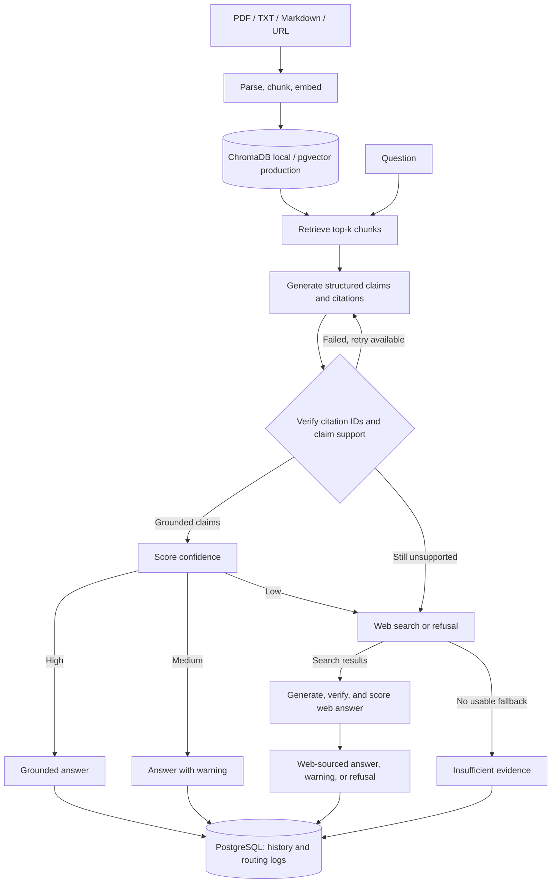

# Axiom

> Start from what you can prove.

Axiom is a citation-grounded retrieval-augmented generation (RAG) agent. Upload
documents, ask questions, and get answers with source quotes, confidence scores,
and visible warnings when evidence is weak. When the corpus cannot support an
answer, Axiom can search the web and verify the resulting citations before
responding.

**The measurable goal: zero unsupported claims reach the user unflagged.**

**Live app:** [axiom-rag.vercel.app](https://axiom-rag.vercel.app) ·
[Backend health](https://axiom-backend-7n5c.onrender.com/health)

The public demo requires no sign-in. All visitors share the same document
corpus and can list, upload, and delete documents. Do not upload confidential material.

## Features

- Ingest PDF, TXT, Markdown, and web pages; retrieve relevant document chunks.
- Check citation IDs and claim support before displaying answers; regenerate
  once on grounding failure, then fall back or refuse if evidence remains insufficient.
- Route answers by confidence: grounded (green), low confidence (yellow), or
  web sources (blue), with a neutral badge for refusals.
- Stream verified answer text with Server-Sent Events (SSE).
- Persist documents, chat history, routing decisions, and spend counters in PostgreSQL.
- Apply request rate limits and token and spend caps.

The current support check uses keyword overlap between a claim and its cited
chunk. It is a lightweight grounding heuristic; passing it does not establish
that every claim is factually correct. NLI-based verification is planned after v1.

## How it works



Answer text is rebuilt from claims that pass verification. Web results pass
through the same grounding gate and carry source URLs. The stream sends a
`status` event immediately; answer `token` events begin after the pipeline
finishes, followed by a `done` event with citations and confidence.

The implemented stack is Python/FastAPI, LlamaIndex, an OpenAI-compatible model
interface (Gemini by default), ChromaDB locally, PostgreSQL with pgvector in
production, and React 18/Vite 5/Tailwind 3.
See [Architecture](docs/Architecture.md) for the full design.

## Quickstart

Run commands from the repository root unless a step says otherwise.

### 1. Configure the environment

Requires Docker with Compose v2 or later for the backend services, plus
**Node 20** and **pnpm 9.15.9** for the frontend. Local Python development uses
**Python 3.11** (the CI version).

```bash
cp .env.example .env
```

In PowerShell, use `Copy-Item .env.example .env`.
Edit `.env` and set:

- `OPENAI_API_KEY` for document embeddings, search, and chat generation. The
  checked-in models use Gemini, so supply a Gemini API key from Google AI Studio
  and retain the template's `OPENAI_API_BASE` compatibility endpoint.
- `TAVILY_API_KEY` for the default live web fallback. Alternatively, configure
  `fallback.provider: brave` in `config.yaml` and set `BRAVE_API_KEY`.

The services can boot without API keys, but embedding and generation requests
need the configured model provider's key. Missing provider credentials return `503 PROVIDER_UNAVAILABLE`,
including when a request reaches web fallback without its search key. To run
without web search, set `fallback.enabled: false` in `config.yaml`; unsupported
questions then receive a flagged corpus answer or refusal.

### 2. Start the backend services

```bash
docker compose up --build --wait
curl http://localhost:8000/health
```

Compose starts **FastAPI, PostgreSQL, and ChromaDB**. The frontend runs separately.
The health response includes `{"status":"ok","service":"Axiom",...}`; it checks
liveness, so it does not confirm that datastores or provider credentials work.

| Service | Local address |
|---------|---------------|
| Backend API | http://localhost:8000/api/v1 |
| Interactive API docs | http://localhost:8000/docs |
| PostgreSQL | `localhost:5432` |
| ChromaDB | `localhost:8001` |

Stop services with `docker compose down`. Adding `-v` also deletes the
PostgreSQL and Chroma named volumes and their stored data.

### 3. Start the frontend

In another terminal:

```bash
cd frontend
corepack enable
pnpm install --frozen-lockfile
pnpm run assert:toolchain
pnpm run dev
```

Open http://localhost:5173. The frontend defaults to
`http://localhost:8000/api/v1`. To use another backend, set `VITE_API_BASE_URL`
in `frontend/.env.local`, including `/api/v1`, and restart Vite. Production
builds read this value at build time. Keep provider keys in the backend environment.

### 4. Try a grounded question

Upload a document in the UI and ask a question it answers. For a small included
example, upload `backend/evals/corpus/aurora-policy.txt`, then ask:

> What is the standard deductible for a water damage claim under the Aurora policy?

Inspect the answer's citation cards and confidence badge. Ask a question outside
the document to exercise web fallback; at least one document must be ingested
before chat is available.

The same example through the API (Bash):

```bash
curl -F "file=@backend/evals/corpus/aurora-policy.txt" \
  http://localhost:8000/api/v1/documents

curl -H "Content-Type: application/json" \
  -d '{"question":"What is the standard deductible for a water damage claim under the Aurora policy?"}' \
  http://localhost:8000/api/v1/chat
```

Use `POST /api/v1/chat/stream` with the same JSON body and `curl -N` to inspect SSE.

## Local backend development

Start the datastores from the repository root:

```bash
docker compose up -d --wait postgres chroma
```

Then install and run the backend locally:

```bash
cd backend
python -m venv .venv
source .venv/bin/activate
python -m pip install -e ".[dev]"
uvicorn app.main:app --reload
```

In PowerShell, activate with `.\.venv\Scripts\Activate.ps1`. Use a Python 3.11
interpreter when creating the virtual environment.

The backend loads the repository-root `.env`, including when started from
`backend/`. Keep its database and Chroma endpoints at the template's
`localhost` defaults. The YAML loader also searches the repository root for
`config.yaml`. If the Compose backend is already running, stop it with
`docker compose stop backend` before starting Uvicorn on port 8000.

## Configuration

Tunable settings live in [config.yaml](config.yaml); secrets and environment
values are documented in [.env.example](.env.example).

| Setting | Default |
|---------|---------|
| Chunk size / overlap | 512 / 64 tokens |
| Maximum upload size | 20 MB |
| Embedding model | `gemini-embedding-001` (1536 dimensions) |
| Generation model | `gemini-3.6-flash` |
| Retrieval | Top 8 chunks, cosine similarity |
| Confidence weights | Retrieval 0.30, citation faithfulness 0.40, claim coverage 0.30 |
| Confidence thresholds | High 0.75, low 0.45 |
| Budget caps | 8,000 tokens/request; 200,000 tokens/day; $10 estimated spend/month |

`MAX_REQUEST_TOKENS`, `DAILY_TOKEN_CAP`, and `MONTHLY_SPEND_USD` override the YAML
budget defaults. Exceeding a cap returns `429 BUDGET_EXCEEDED`. Routing and
spend summaries are available at `GET /api/v1/metrics`.

`CORS_ORIGINS` overrides the allowed browser origins for a deployment, and
`VECTOR_STORE_BACKEND` selects `chroma` or `pgvector` per environment. Production
uses `pgvector`; local development defaults to Chroma.

The runtime implements OpenAI-compatible embedding/generation, both vector
backends, and Tavily/Brave web search. Groq and sentence-transformers have
configuration entries, but their runtime adapters are not implemented.
Answer-cache settings are also present, but chat caching is not implemented.
Changing the embedding model requires full corpus re-ingestion; see
[ADR-0001](docs/adr/ADR-0001-embedding-model-choice.md). To use OpenAI directly,
clear `OPENAI_API_BASE` and select OpenAI-supported model names in `config.yaml`;
see [ADR-0003](docs/adr/ADR-0003-openai-compatible-endpoint-override.md).

## API

All paths below use the `/api/v1` prefix. Request and response schemas are
available in the running backend's [interactive docs](http://localhost:8000/docs).

| Method | Path | Purpose |
|--------|------|---------|
| `POST` | `/documents` | Upload a PDF, TXT, or Markdown file (multipart `file`) |
| `POST` | `/documents/url` | Ingest a web page (`{"url":"..."}`) |
| `GET` | `/documents` | List ingested documents |
| `DELETE` | `/documents/{doc_id}` | Delete a document and its chunks |
| `POST` | `/search` | Semantic search (`query`, optional `top_k`) |
| `POST` | `/chat` | Ask a grounded question (`question`, optional `session_id`) |
| `POST` | `/chat/stream` | Same chat request, returned as SSE |
| `GET` | `/sessions/{session_id}` | Read chat history for a session |
| `GET` | `/metrics` | Routing rates, spend usage, and budget caps |
| `GET` | `/health` | Liveness; also available at unversioned `/health` |

Reuse the returned `session_id` to group subsequent turns in the same history.
Once a stream opens, pipeline failures arrive as an SSE `error` event.

## Checks and evaluation

Run the backend checks from `backend/` with the development dependencies installed:

```bash
ruff check .
ruff format --check .
mypy
pytest
```

Run the frontend checks from `frontend/`:

```bash
pnpm run assert:toolchain
pnpm run build
```

The golden set contains 30 questions: 18 in-corpus, 6 out-of-corpus, and
6 adversarial. Offline evaluations exercise the real pipeline with deterministic
embedding, vector-store, model, and web-search doubles, without live provider calls.

```bash
cd backend
pytest evals/
```

| Metric | Recorded offline fixture result | Target |
|--------|------------------------|--------|
| Citation precision | 1.000 (24/24) | >= 0.95 |
| Unsupported citations escaping the gate | 0 | 0 |
| Confident, unflagged corpus answers to out-of-corpus/adversarial questions | 0 | 0 |
| Web-fallback rate | 0.200 (6/30) | — |
| Faithfulness (RAGAS) | Requires live evaluation | >= 0.85 |
| Answer relevancy (RAGAS) | Requires live evaluation | >= 0.80 |

These results measure behavior on the synthetic corpus with scripted providers.
They do not measure live-model accuracy. The
[hallucination suite](backend/evals/test_hallucination.py) also exercises a hostile
model double that always fabricates citations.

For live RAGAS scoring, configure the provider key as `OPENAI_API_KEY` and its
`OPENAI_API_BASE` in the repository-root `.env`, then start ChromaDB. From
`backend/`, install the optional evaluation dependencies and opt in to live
provider calls, which consume quota and may incur charges:

```bash
python -m pip install -e ".[dev,eval]"
pytest evals/ -v -s --run-llm
```

Completed answers and judge metrics are checkpointed under ignored `data/ragas/`.
If quota is exhausted, rerun with unchanged code, corpus, and configuration to
resume. A completed run prints its scores and writes a dated report under
`backend/evals/reports/`.

Threshold tuning confirmed the defaults (`high=0.75`, `low=0.45`): 18/18
in-corpus answers remain trusted before and after tuning, with zero escapes.
At `high=0.95`, only 3/18 remain trusted and 15 are flagged. Reproduce the sweep
from `backend/` with `python -m evals.tuning`; see the
[tuning report](backend/evals/reports/threshold-tuning.md) and
[evaluation strategy](docs/EVAL.md).

## Deployment and status

**Project status: Complete.** The v1 application is implemented and deployed at
the public frontend and backend URLs above. Manual deployment checks confirmed
document upload, a cited in-corpus answer, a web-sourced answer, and refusal of
an unsupported claim.

Formal release evidence still to be recorded: live RAGAS scores, the P95 latency
measurement, and a demo video shorter than 90 seconds. No result is claimed for
an unfinished measurement. See [Phases](docs/Phases.md) and the
[release checklist](docs/RELEASE_CHECKLIST.md) for the remaining evidence.

Production runs a Render backend, Neon PostgreSQL with pgvector, and a Vercel
frontend. Follow the [deploy runbook](docs/DEPLOY_RUNBOOK.md), including
`VITE_API_BASE_URL` for the frontend and `CORS_ORIGINS` for the backend.
The local/production vector-store split is documented in
[ADR-0002](docs/adr/ADR-0002-vector-store-choice.md).

## Repository layout

```text
backend/
  app/api/        FastAPI routes and request/response schemas
  app/rag/        Parsing, chunking, prompts, generation, citation verification
  app/confidence/ Confidence scoring and routing
  app/llm/        Embedding and generation providers, budget wrappers
  app/search/     Tavily and Brave web-search providers
  app/vector/     Chroma, pgvector, and in-memory vector stores
  app/db/         SQLAlchemy models and database lifecycle
  app/services/   Ingestion, retrieval, chat, sessions, metrics
  app/core/       Budget guard, errors, rate limiting, security headers
  tests/          Backend unit and API tests
  evals/          Golden set, synthetic corpus, harness, and tuning reports
frontend/         React chat UI, uploads, citation cards, confidence badges
data/             Local data directory (corpora and vector-store data gitignored)
evals/reports/    Reserved top-level report directory
docs/             Requirements, architecture, design, rules, and runbooks
```

## Documentation

| Document | Contents |
|----------|----------|
| [Prompt](docs/Prompt.md) | Master build prompt (v1.1) |
| [PRD](docs/PRD.md) | Product requirements |
| [Architecture](docs/Architecture.md) | System design, pipeline, tech stack |
| [Design](docs/Design.md) | API contracts, data models, prompts, UX |
| [Rules](docs/Rules.md) | Grounding, code, test, and documentation rules |
| [Phases](docs/Phases.md) | Build order and exit criteria |
| [Evaluation](docs/EVAL.md) | Evaluation strategy and targets |
| [Deploy runbook](docs/DEPLOY_RUNBOOK.md) | Render, Vercel, and Neon walkthrough |
| [Release checklist](docs/RELEASE_CHECKLIST.md) | Live evaluation, latency, and demo evidence |
| [Contributing](docs/CONTRIBUTING.md) | Workflow and merge checklist |
| [ADRs](docs/adr/) | Architecture decision records |
